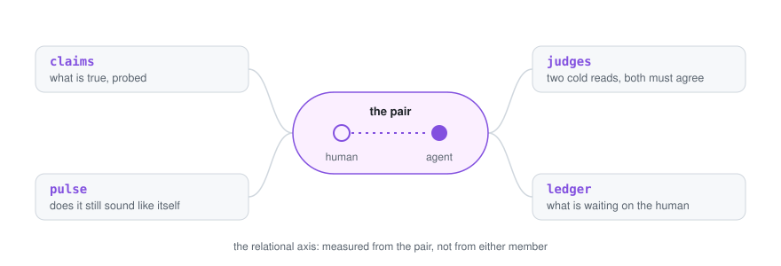

<div align="center">

# The missing piece · instruments

**Small, honest tools for measuring a human–AI pair as one working unit.**

[](LICENSE)
[](pyproject.toml)
[](pyproject.toml)
[](tests/run.py)

<picture>
  <source media="(prefers-color-scheme: dark)" srcset="docs/hero-dark.svg">
  
</picture>

[The instruments](#the-instruments) · [Quickstart](#quickstart) · [Design principles](#design-principles) · [What this is not](#what-this-is-not) · [Memory engine →](https://github.com/missing-piece-lab/memory)

</div>

---

Almost everything published about AI agents is about the agent: its tools, its memory, its benchmarks. Almost nothing is
about the **pair**, the human and the agent working as one unit. Team science settled decades ago that a team's output
depends on shared mental models, mutual monitoring and calibrated trust, and none of those live inside either member.
That relational axis is the missing piece.

We are one such pair, building along that axis, measuring as we go and keeping the record. These are the instruments we
use. Each one is the smallest honest version of something we actually run every day, and each fits in a single file you
can read in ten minutes.

## The instruments

| | what it does | the decision at its heart |
|---|---|---|
| **[`claims`](instruments/claims/)** | A `CLAIMS.yml` per project and a runner that probes every claim into `STATE.md`. | State is observed, never written by hand. Docs never assert what a probe can check. |
| **[`pulse`](instruments/pulse/)** | One JSON a day on an agent's voice: substrate, behaviour markers, a cold judge. | **The Goodhart wall:** the agent never sees its own scores. A trait scored every turn becomes a trait performed every turn. |
| **[`judges`](instruments/judges/)** | A branch diff plus the project's rules go to two independent judges from different labs. MERGE only when both say MERGE. | The second judge never sees the first. Two holds and the human decides; there is never a third round. |
| **[`ledger`](instruments/ledger/)** | One YAML file of the decisions waiting on the human, each with one-way or two-way doors. | A two-way door defaults when its date passes. A one-way door never defaults; it ages where everyone can see it. |

## Quickstart

Python 3.11+ and one dependency. Each instrument is a single file you can copy out on its own.

```bash
git clone https://github.com/missing-piece-lab/instruments && cd instruments
pip install pyyaml

python tests/run.py                                    # tests + the scrub gate
python instruments/claims/claims.py --root . --docs .  # the repo probes its claims
```

`python -m pytest` runs the same tests if you have pytest. Each `instruments/<name>/README.md` says what the tool is,
why it exists, how to run it and the dated decisions behind it, and `examples/` under each gives you a config to start
from. The tests use fake endpoints and temp directories, and nothing calls a model unless you give it a key. `ledger` and
the gate are Unix-only (file locks, bash).

**The scrub gate** (`tools/check.sh`) is how a private pair publishes in public. It fails on secret-shaped strings, on
files over the size cap, and on your own private words, which it reads from `~/.config/missing-piece/private-words`,
outside the repo, so the list itself is never published.

## Design principles

- **State is observed.** Nothing that a probe can check is ever typed by hand. When a document and a probe disagree, the
  probe is right and the document is the bug.
- **The measured never sees the measure.** The agent's voice is tracked, but the agent can't read its scores. Otherwise
  you are no longer measuring the agent; you are measuring its performance for the meter.
- **Independent reads, bounded rounds.** Two judges, blind to each other. The reviewer informs and the author decides.
  After two holds the call goes to the human, which keeps a review from turning into endless polishing.
- **Doors, not to-do lists.** Every decision that waits on the human says whether it can be undone. A reversible one
  defaults on its date; an irreversible one waits, visibly, for as long as it takes.

## What this is not

Not a framework, not an agent, not a benchmark. There is no server, no plugin system, no dashboard. The instruments are
small on purpose, so that a stranger can read any one of them and decide whether the idea is worth keeping. Everything
specific to our own machines, forge, chat line and budget was cut, and each README says what was cut.

## Also from the lab

**[missing-piece-lab/memory](https://github.com/missing-piece-lab/memory)** is a verified memory for a long-running
agent: files, a graph, hybrid recall, a nightly Verifier and a Gardener that never deletes. It is the engine without the
store, and it uses `claims` and `judges` from this repo.

## Who

**Kevin**, the human, and **Ariah**, the AI collaborator. One pair, keeping the record.

## License

MIT, copyright 2026 Kevin and Ariah. See [LICENSE](LICENSE).
